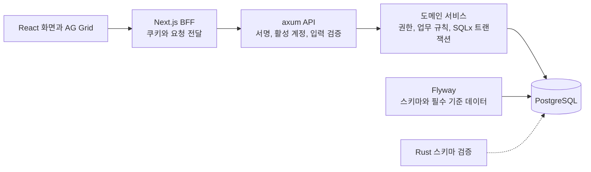

# VIBE-HR Rust backend migration

The Rust release passed the isolated CI, real BFF browser checks and the previous-image rollback rehearsal on 2026-11-19. Production rollout requires a separate decision. See the [verification report](verification.md).

The application deploys as one process. HTTP handlers read requests and map response DTOs. Each writing domain service owns the SQL transaction for its business operation. Shared middleware verifies access tokens against current account state and validates BFF assertions. Route-specific services enforce roles, menu access, action permissions and ownership. Session renewal reads the database policy. Financial services retain the current rounding and duplicate-operation rules.

Flyway remains responsible for schema and reference rows. Keep versioned scripts and recorded checksums intact. The final deployment must run the migration and validation steps on both a fresh database and a restored existing database. Rust application startup and normal API calls must not implicitly seed arbitrary databases.

## Validation and rollback

Capture current routes and non-HTTP responsibilities, then compare each domain against a running Spring reference using two isolated copies of the same initial database. Compare status, response shape, values and committed changes, including rejected operations. Re-run browser workflows through the Next.js BFF with Spring stopped. Require actual evidence for the financial and authorization behavior in addition to generic UI smoke tests.

Hold default traffic on Spring until the complete inventory has matching evidence. Rehearse switching the BFF target to the Rust service and back to the previous Spring build using a compatible database. Before cutover verify that any candidate writes can still be read by Spring, including replay and financial state. No reverse DDL is part of traffic rollback. Any data reconciliation or production rollout requires a separate decision.
